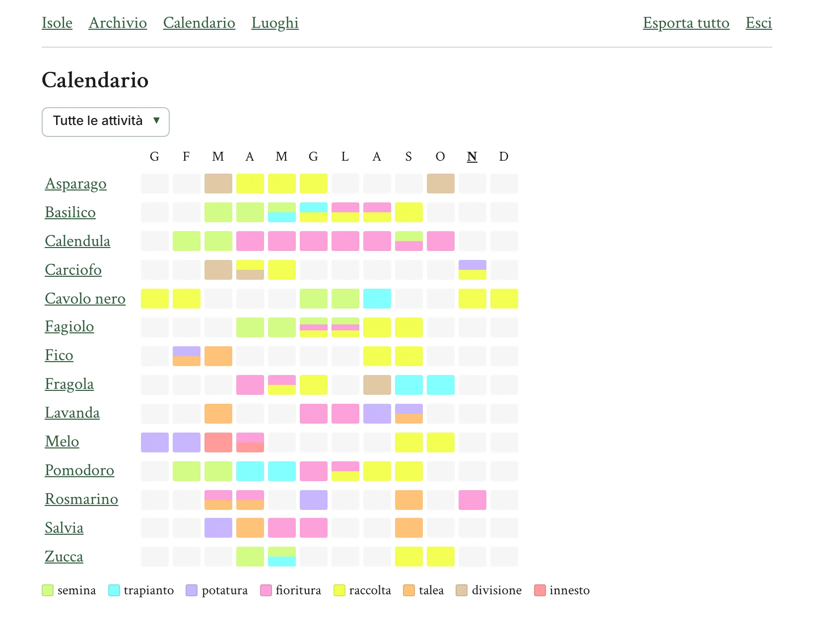

# Cycles of Care · diario

Un diario personale per prendersi cura: le zone di coltivazione (le **isole**), le **specie** che ci vivono, le **note** con foto e video, i **luoghi** sulla mappa e un **calendario** che mostra, mese per mese, cosa c'è da fare per ogni pianta.

È una web app installabile sul telefono (PWA) e funziona anche offline. Ogni copia è privata: si collega al **tuo** database e può entrarci solo il **tuo** account.

Questa è la mia copia personale. Se ti piace, puoi installartene una tua seguendo la guida qui sotto. È gratis, e i tuoi dati restano tuoi.

<p align="center">
  
</p>

---

## Cosa fa

- **Isole**: le zone del giardino, ognuna con una descrizione, le specie che contiene (e il loro ruolo) e un diario di note datate con foto o video.
- **Archivio**: la scheda di ogni specie, con il nome comune, il nome scientifico e delle note libere.
- **Calendario**: una tabella specie × mese, con una barra colorata per ogni attività (semina, potatura, raccolta…). Si può filtrare per attività.
- **Luoghi**: punti con coordinate, anche presi dalla posizione del telefono, collegabili a un'isola e aperti su OpenStreetMap.
- **Esporta tutto**: scarica uno zip con tutti i dati in JSON e CSV, più un file Markdown per ogni isola.
- **Offline**: i dati già visti restano consultabili anche senza connessione.

## Come è fatto

| Parte | Tecnologia |
|---|---|
| Interfaccia | React 18, TypeScript, Vite, Tailwind CSS 4 |
| Database, login, file | [Supabase](https://supabase.com), piano gratuito |
| Hosting | GitHub Pages, con deploy automatico tramite GitHub Actions |
| Offline / installazione | vite-plugin-pwa |

Non c'è un server da mantenere: la pagina è statica e parla direttamente con Supabase. La sicurezza è affidata alle regole del database (Row Level Security): ogni tabella e ogni file risponde solo all'email del proprietario.

---

## Installa la tua copia

Ti servono:

- un account [GitHub](https://github.com)
- un account [Supabase](https://supabase.com) (il piano gratuito basta)
- per provarla in locale (facoltativo): [Node.js](https://nodejs.org) 20 o più recente e `git`

Ci vogliono circa 15 minuti.

### 1. Copia il repository

Premi **Fork** in alto a destra su questa pagina. Avrai così il tuo repository, `https://github.com/TUO-UTENTE/cycles`.

> Con un account GitHub gratuito, GitHub Pages funziona solo se il repository è **pubblico**. Il codice è pubblico, i tuoi dati no: stanno su Supabase, protetti dal login.

### 2. Crea il progetto Supabase

1. Su [supabase.com/dashboard](https://supabase.com/dashboard) premi **New project**, scegli un nome, una password per il database e una regione vicina a te (per esempio *Central EU*).
2. Aspetta un paio di minuti che il progetto sia pronto.

### 3. Chiudi le iscrizioni e crea il tuo utente

1. **Authentication → Sign In / Providers → Email**: disattiva **Allow new users to sign up** e salva. Così nessun altro potrà registrarsi.
2. **Authentication → Users → Add user → Create new user**: inserisci la tua email e una password e spunta **Auto Confirm User**.

### 4. Crea le tabelle

1. Apri `supabase/schema.sql` dal tuo fork (puoi modificarlo direttamente su GitHub, con l'icona della matita) oppure copialo in un editor.
2. Cerca la funzione `is_owner()` e **sostituisci l'email segnaposto con la tua**, la stessa del passo 3. È l'unica email a cui il database risponderà: se non coincide, dopo il login vedrai tutto vuoto.
3. Su Supabase apri **SQL Editor → New query**, incolla tutto il contenuto di `schema.sql` e premi **Run**. Lo script crea le tabelle, le regole di sicurezza e il bucket privato `media` per le foto.
4. Facoltativo: fai lo stesso con `supabase/seed.sql` se vuoi partire da dati di esempio (10 isole, una cinquantina di specie e il loro calendario). Se vuoi partire da zero, saltalo.

### 5. Configura le email di accesso (consigliato)

Oltre alla password, l'app permette di entrare, o di reimpostare la password, con un **codice** ricevuto per email. Perché funzioni, le email devono contenere il codice:

1. **Authentication → Emails → Templates**
2. Nei template **Magic Link** e **Reset Password**, aggiungi `{{ .Token }}` nel testo, per esempio:
   ```html
   <p>Il tuo codice: <strong>{{ .Token }}</strong></p>
   ```
3. **Authentication → URL Configuration → Site URL**: metti l'indirizzo della tua app, cioè `https://TUO-UTENTE.github.io/cycles/` (lo avrai al passo 7).

> Il servizio email integrato di Supabase invia poche email l'ora. Per un uso personale basta.

### 6. Prendi le chiavi di Supabase

In **Project Settings → API** (o **API Keys**) copia:

- **Project URL**, per esempio `https://abcd1234.supabase.co`
- **anon / publishable key**, la chiave pubblica

> La chiave *anon* è fatta per stare nel browser: senza login non dà accesso a nulla. **Non usare mai** la chiave `service_role` / *secret*.

### 7. Pubblica su GitHub Pages

Nel tuo fork su GitHub:

1. **Settings → Secrets and variables → Actions → New repository secret**: crea due secret:
   - `VITE_SUPABASE_URL` con il Project URL
   - `VITE_SUPABASE_ANON_KEY` con la chiave anon
2. **Settings → Pages → Build and deployment → Source**: scegli **GitHub Actions**.
3. Scheda **Actions**: nei fork i workflow sono disattivati, quindi premi **I understand my workflows, go ahead and enable them**.
4. Il deploy parte a ogni push su `main`. Per lanciarlo la prima volta basta un commit qualsiasi, per esempio la modifica a `schema.sql` del passo 4, oppure una riga in questo README.
5. Quando il workflow è verde (circa 1–2 minuti), l'app è online su:
   **`https://TUO-UTENTE.github.io/cycles/`**

Accedi con l'email e la password del passo 3.

### 8. Installala sul telefono

Apri l'indirizzo dell'app nel browser del telefono:

- **iPhone (Safari)**: Condividi → *Aggiungi alla schermata Home*
- **Android (Chrome)**: menu ⋮ → *Installa app*

---

## Sviluppo in locale (facoltativo)

```bash
git clone https://github.com/TUO-UTENTE/cycles.git
cd cycles
cp .env.example .env      # poi inserisci URL e chiave anon del passo 6
npm install
npm run dev               # apre l'app su http://localhost:5173
```

Altri comandi:

| Comando | Cosa fa |
|---|---|
| `npm run build` | controlla i tipi e crea la versione di produzione in `dist/` |
| `npm run preview` | serve in locale la build di `dist/` |

## Personalizzare

- **Le tue isole e specie**: si creano e si modificano dall'app. Il file `seed.sql` serve solo come punto di partenza.
- **Nome e colori dell'app installata**: si cambiano in `vite.config.ts` (`name`, `short_name`, `theme_color`).
- **Icone**: stanno in `public/`.
- **Stile**: `src/index.css`.

## Ricevere gli aggiornamenti

Se questo repository riceve novità, sul tuo fork premi **Sync fork → Update branch**. Il deploy riparte da solo. I tuoi dati non vengono toccati, perché stanno su Supabase.

## Backup

Usa **Esporta tutto** di tanto in tanto: scarica uno zip con le cartelle `json/` e `csv/` e un file `.md` per ogni isola. Le foto restano nel bucket `media` di Supabase (**Storage**).

## Problemi comuni

| Sintomo | Causa probabile |
|---|---|
| Dopo il login è tutto vuoto e non si riesce a salvare | L'email in `is_owner()` (`schema.sql`) non è identica a quella del tuo utente. Correggila e rilancia lo script. |
| La pagina online è bianca | Mancano i secret `VITE_SUPABASE_URL` / `VITE_SUPABASE_ANON_KEY`, oppure sono stati aggiunti dopo il deploy: rilancia il workflow da **Actions → Re-run jobs**. |
| Il codice via email non arriva o arriva solo un link | Manca `{{ .Token }}` nei template email (passo 5), oppure è stato raggiunto il limite di invii orari di Supabase. |
| Errore 404 su GitHub Pages | **Settings → Pages → Source** non è impostato su *GitHub Actions*, oppure il workflow non è ancora terminato. |
| Il progetto Supabase risulta "paused" | I progetti gratuiti vanno in pausa dopo un periodo senza attività: riattivalo dalla dashboard. |
| Dopo un aggiornamento l'app mostra la versione vecchia | Chiudila e riaprila: la PWA si aggiorna da sola al riavvio successivo. |